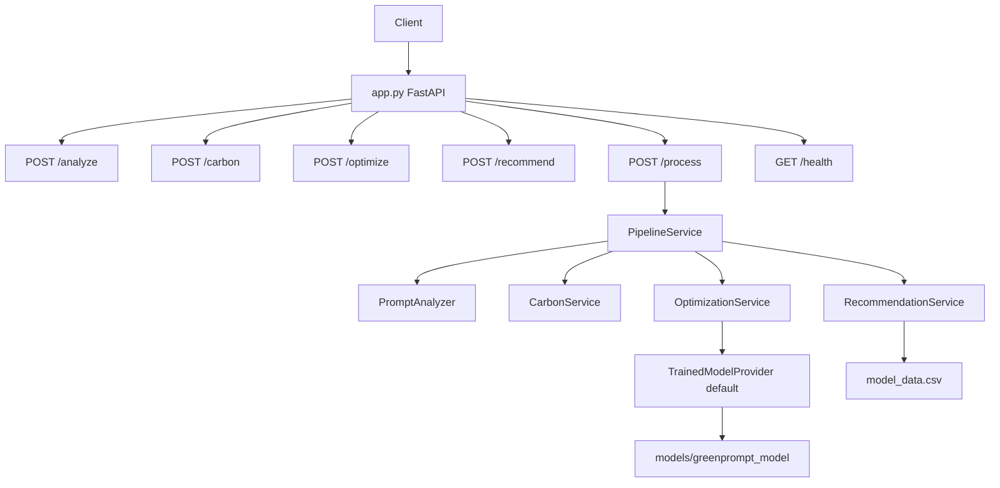

# 03 — Backend Architecture Document

**Stack:** FastAPI, Pydantic, tiktoken, PyTorch/Transformers (optimizer), PyYAML, pytest.

---

## 1. Application Entry

- `main.py` — runs uvicorn on `app:app` with reload
- `app.py` — creates FastAPI app, CORS from config, request timing middleware, global exception handler, includes routers

Registered routes:
- Analyzer `/analyze`
- Carbon `/carbon`
- Optimizer `/optimize`
- Recommendation `/recommend`
- Process `/process`
- Health `/health`

---

## 2. Architecture Diagram

---

## 3. Endpoint Specifications

### 3.1 `GET /health`

| Field | Detail |
|-------|--------|
| Input | None |
| Processing | Smoke: analyzer on fixed string; carbon weight load; optimizer `provider_name`; recommendation load Coding |
| Output | `{ status, version, modules }` |
| Errors | 503 if any module not ok |
| Fake? | No — but optimizer check does **not** load model weights |

### 3.2 `POST /analyze`

| Field | Detail |
|-------|--------|
| Input | `{ "prompt": string }` — min 2, max 10000 chars after strip |
| Processing | clean → tiktoken count → task classify → prompt-type classify → char/word counts |
| Output | `{ success, analysis: { prompt, prompt_type, task_type, category, token_count, character_count, word_count } }` |
| Errors | 400 validation/tokenizer; 500 unexpected |
| Fake? | **No** |

### 3.3 `POST /carbon`

| Field | Detail |
|-------|--------|
| Input A | `{ "prompt" }` — analyzes first |
| Input B | `{ token_count, prompt_type, task_type }` pre-analyzed |
| Processing | YAML weights → GCS formula |
| Output | `{ success, carbon: { token_count, prompt_type, task_type, prompt_weight, task_weight, scaling_constant, green_carbon_score } }` |
| Errors | 400 unknown types / invalid tokens |
| Fake? | **No** |

### 3.4 `POST /optimize`

| Field | Detail |
|-------|--------|
| Input | `{ "prompt" }` |
| Processing | Analyze original → generate candidates (beam search default) → rank → comparison metrics |
| Output | original/optimized prompts, tokens, types, carbon scores, reduction % |
| Errors | 400 validation / semantic rejection / provider failure mapped |
| Fake? | Default **trained model**; `mock` is test-only |

### 3.5 `POST /recommend`

| Field | Detail |
|-------|--------|
| Input A | `{ "prompt" }` |
| Input B | `{ "task_type", "category"? }` |
| Processing | Map category → load CSV → normalize → GMES → top 5 → reasons |
| Output | recommended_model, score, top_models[], reason[] |
| Fake? | **No** — CSV-driven |

### 3.6 `POST /process`

| Field | Detail |
|-------|--------|
| Input | `{ "prompt" }` |
| Processing | PipelineService order below |
| Output | Full `pipeline` + `metadata.processing_time_ms` |
| Errors | 400 bad body; 500 any step failure |
| Fake? | **No** |

**Pipeline order (`pipeline_service.py`):**
1. Analyze original
2. Carbon(original analysis)
3. Optimize (internal re-analyze + generate + rank)
4. Carbon(optimized tokens/types)
5. Recommend from optimized task type

---

## 4. Validation Patterns

- Pydantic models per module
- Analyzer/optimizer: strip, length bounds
- Carbon: positive integer tokens; known prompt/task types
- Recommendation: known task types / non-empty filtered dataset

---

## 5. Error Handling

| Layer | Behavior |
|-------|----------|
| Route try/except | Module-specific JSON `{ success: false, message }` |
| Global handler | Hides details in production |
| Pipeline | Any step failure → ErrorResponse → HTTP 500 |

**Gap:** Validation-like failures inside pipeline still surface as 500 rather than 400.

---

## 6. Configuration Notes

| Setting | Location | Default |
|---------|----------|---------|
| `LLM_PROVIDER` | `optimizer/config.py` | `trained_model` (**used**) |
| `LLM_PROVIDER` | `backend/config.py` | `rule_based` (**unused by optimizer**) |
| `TRAINED_MODEL_PATH` | optimizer config | `models/greenprompt_model` |
| `MAX_PROMPT_LENGTH` | root config env | Not wired into analyzer (hardcoded 10000) |
| Beam / candidates | optimizer config | beams 5, candidates 5, similarity ≥ 0.50 |

---

## 7. Service Instantiation

- Route modules create **local** service instances
- `/process` and `/health` use **ModuleRegistry** singletons

Recommendation dataset cache is module-level in `dataset_loader.py`, so both paths share cache once loaded.

---

## 8. Logging & Observability

- Rotating file + stdout (`utils/logging.py`)
- Request timing middleware
- Pipeline logs task type, recommended model, token delta

---

## 9. Backend Integrity Summary

Production endpoints compute real values. Primary risks are **config dual defaults**, **shallow health check for the model**, and **scientific interpretation** of GCS/weights — not fabricated numbers.
