# 09 — Flowcharts for Every Module

All diagrams are Mermaid. They reflect **implemented** code paths.

---

## 1. Overall Project

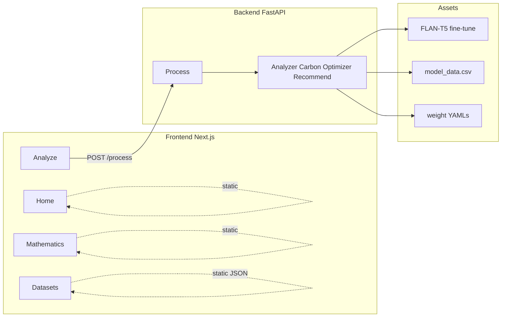

---

## 2. Frontend Architecture

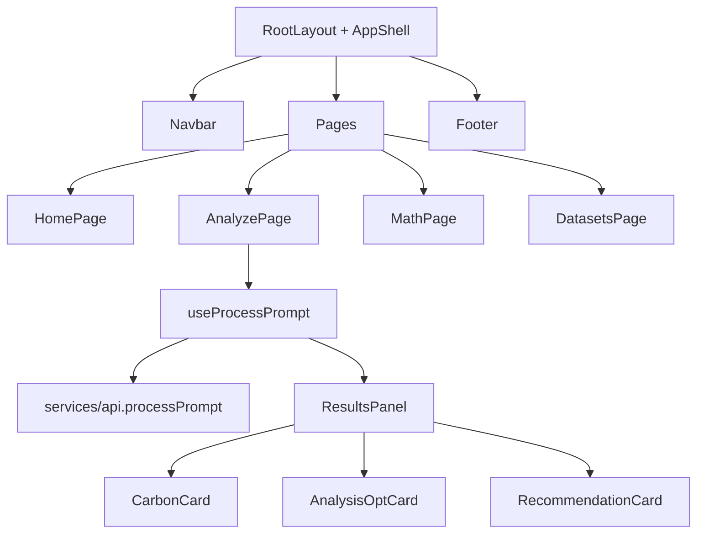

---

## 3. Backend Architecture

```mermaid
flowchart TB
  App[app.py] --> R1[/analyze]
  App --> R2[/carbon]
  App --> R3[/optimize]
  App --> R4[/recommend]
  App --> R5[/process]
  App --> R6[/health]
  R5 --> PS[PipelineService]
  PS --> Registry[ModuleRegistry]
  Registry --> A[PromptAnalyzer]
  Registry --> C[CarbonService]
  Registry --> O[OptimizationService]
  Registry --> Rec[RecommendationService]
```

---

## 4. Prompt Analysis

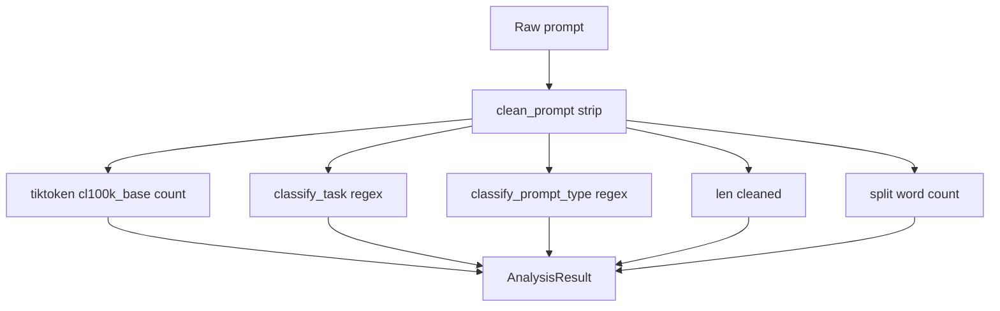

---

## 5. Prompt Optimization

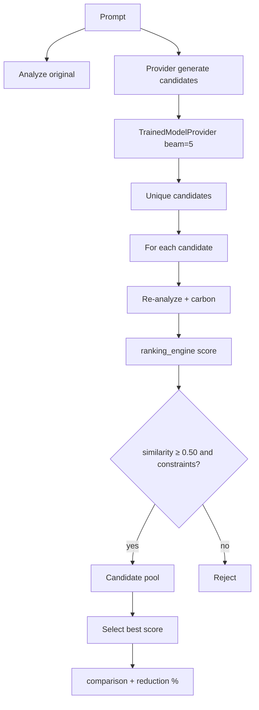

---

## 6. Carbon Calculation

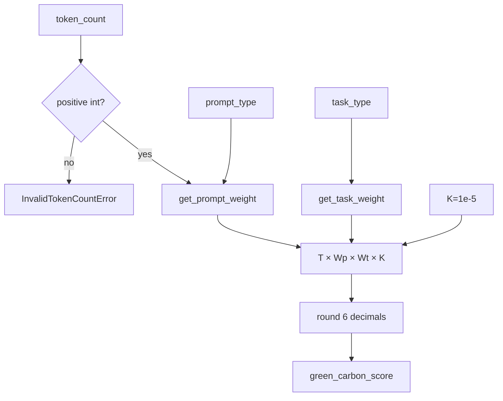

---

## 7. Model Recommendation

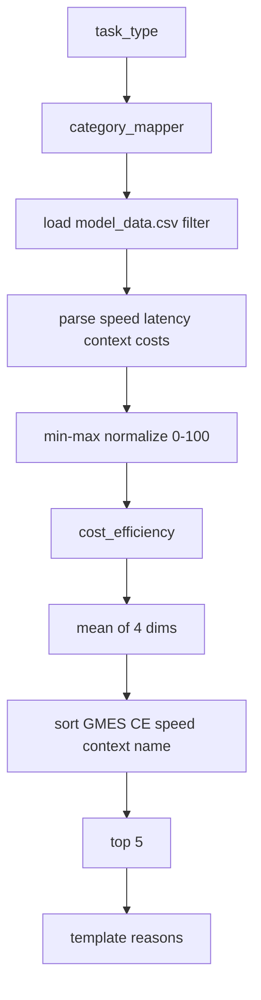

---

## 8. Training Pipeline

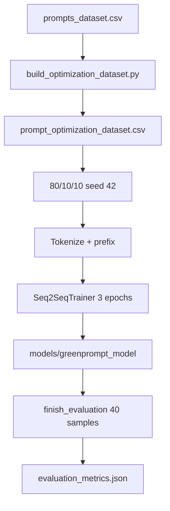

---

## 9. Inference Pipeline (Trained Model)

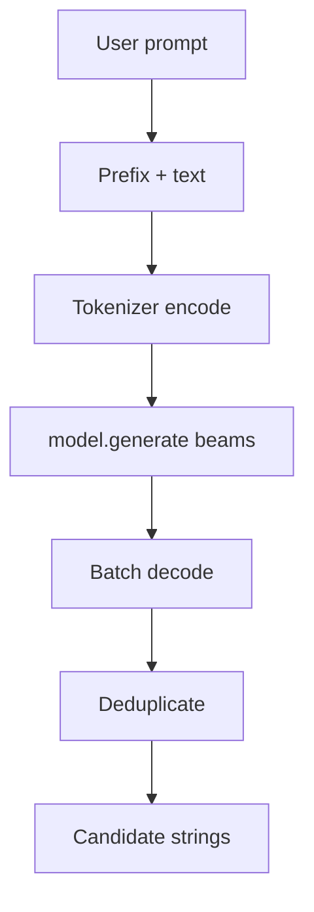

---

## 10. Dataset Flow

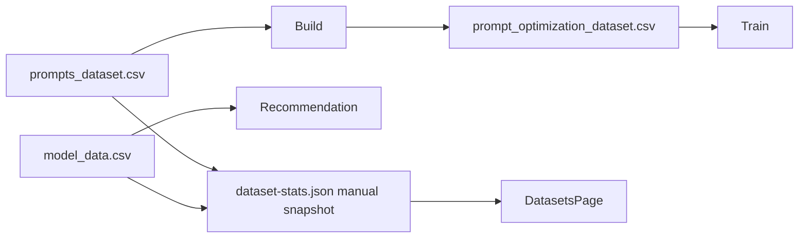

---

## 11. API Flow

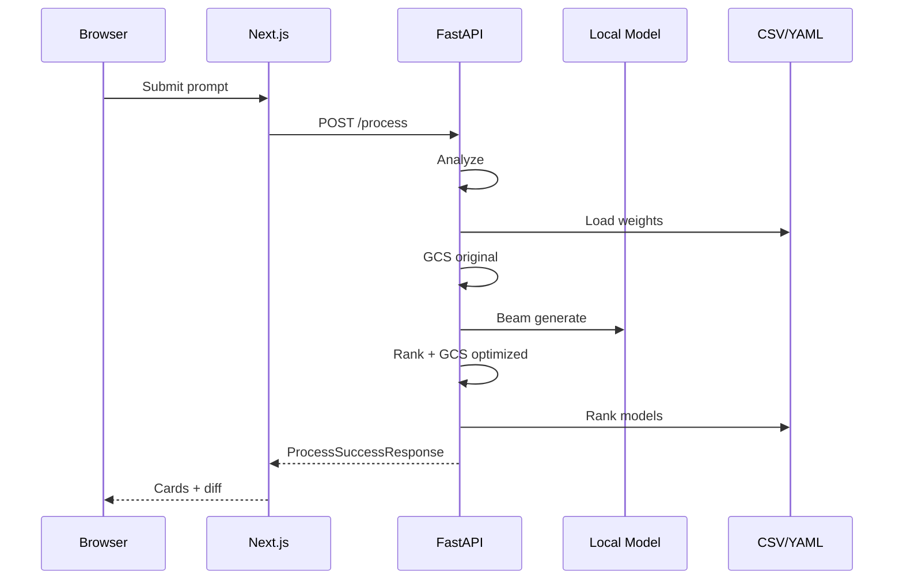

---

## 12. User Flow

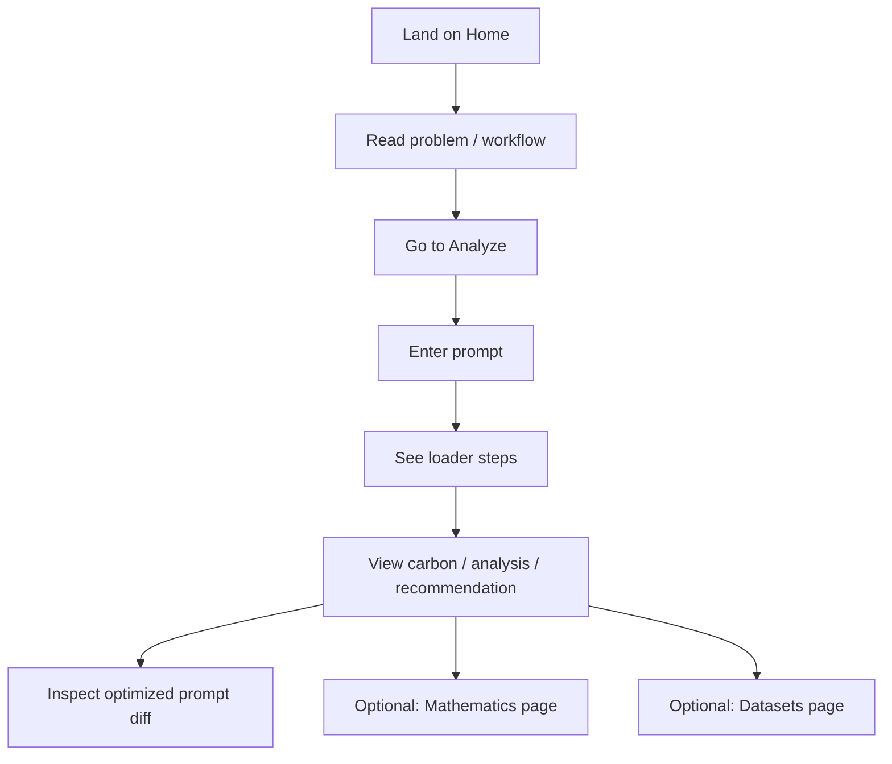
